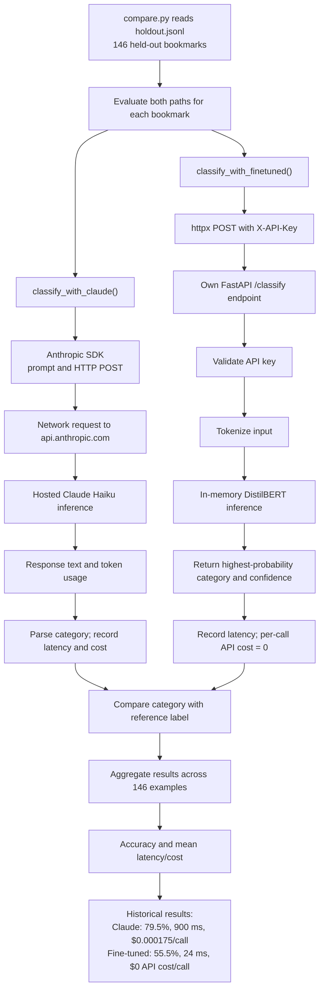

# Classification API: Questions and Answers

[中文](classify-api-问答.md) | English

> Translation of the September 30 notes. The original also refers to a copy in the Jetstar interview-preparation materials. This file preserves that historical discussion; it is not a new production-integration claim or a new benchmark run. Later AWS/GCP lab checks also invoke this service, so statements below about the evaluation script being the only caller describe the original benchmark context.

## Where is the classification API? Two paths that are easy to confuse

### 1. Production bookmark classification: `lib/claude.ts`

Workspace path: `AI现在项目/6-bookmark/linknest/lib/claude.ts`.

This is the code described in the original notes as handling classification for real Linknest users, by calling Claude Haiku:

```ts
// lib/claude.ts
export async function classifyBookmark(input: {...}) {
  const msg = await getClient().messages.create({
    model: CHEAP_CHAT_MODEL,   // From lib/model-router.ts
    max_tokens: 128,
    ...
  });
}
```

This illustrative excerpt omits implementation details. The production path described in those notes runs when a user saves a new bookmark.

### 2. Self-hosted benchmark service: `/classify` in this repository's `app/main.py`

```python
# app/main.py — excerpt from the original notes
@app.post("/classify", response_model=ClassifyResponse)
def classify(body: ClassifyRequest, x_api_key: str | None = Header(default=None)):
    check_auth(x_api_key)
    text = f"{body.title} {body.description}".strip()
    inputs = ml["tokenizer"](text, truncation=True, padding=True, max_length=128, return_tensors="pt")
    with torch.no_grad():
        logits = ml["model"](**inputs).logits
        probs = torch.softmax(logits, dim=-1)[0]
    top_id = int(torch.argmax(probs).item())
    return ClassifyResponse(
        category=ml["model"].config.id2label[top_id],
        confidence=round(float(probs[top_id]), 4),
    )
```

This is an independent FastAPI service for comparison with Claude Haiku. The original benchmark did not integrate it into Linknest production traffic; its caller was this repository's `eval/compare.py`. Subsequent cloud smoke tests do not, by themselves, constitute production integration.

| | `lib/claude.ts` | `/classify` in `app/main.py` |
| --- | --- | --- |
| Caller in the original notes | Real Linknest users in production | This repository's evaluation script |
| Inference | Claude Haiku API over the network to Anthropic | Fine-tuned DistilBERT loaded into service memory |
| Role | Production feature | Benchmark infrastructure |

## How were the benchmark percentages calculated?

### Data sources

The original notes describe:

- `training/training-data.jsonl`: 971 labeled bookmarks exported from Linknest's real database.
- `eval/holdout.jsonl`: 146 held-out examples, not used in training.
- A combined 1,117 examples, split before training.

These counts are preserved from the source note, not reconciled by a fresh data audit. The separate [PoC decision memo](../POC_DECISION_MEMO.md) describes 971 exported records and an 85/15 split, so the historical dataset accounting should be checked before reusing the combined-total claim. The purpose of a holdout is to measure generalization on examples excluded from training.

### What `compare.py` calls

For each held-out bookmark, the original explanation describes running both paths against the same input:

```python
c_cat, c_ms, c_cost = classify_with_claude(title, description)
f_cat, f_ms, f_cost = classify_with_finetuned(title, description)
```

These statements illustrate the two calls, not concurrent Python execution by themselves.

The Claude path calls the configured Haiku model, records latency, estimates cost from reported input/output token usage and the configured prices, and compares the category with the reference label. The original notes name `claude-haiku-4-5-20251001`; this is a historical configuration reference rather than a newly verified model selection.

The fine-tuned path calls the deployed `/classify` endpoint, records elapsed time and the returned category, and records a per-call model API cost of zero. Hosting costs are excluded.

### Accuracy, latency, and cost

```python
claude_correct += c_cat == truth
accuracy = claude_correct / n         # 116 / 146 ≈ 79.5%
avg_latency = claude_latency_total / n
avg_cost = claude_cost_total / n
```

Accuracy is the number of correct predictions divided by the number of evaluated examples. Latency and per-call cost use arithmetic means. The reported speed ratio is `900 ms / 24 ms ≈ 37.5`.

### Why was the reported 55.5% accuracy low?

The source notes record this distribution for the 146 holdout examples:

```text
27 Technology   20 Education    18 Finance
12 Productivity 11 Reference    11 Shopping
 9 Travel        8 Entertainment 7 Business
 7 Health        6 Social        6 Design
 2 Politics      1 Sports        1 Food
```

Politics, Sports, and Food account for only four examples in that list. The original discussion attributes the accuracy gap to class imbalance and limited training examples in minority categories. This is the recorded diagnosis, not proof that imbalance is the only cause; the listed holdout counts alone do not establish the training distribution or per-class model performance. The source also refers to 17 categories overall, whereas the displayed distribution contains 15 labels.

On September 30, `eval/compare.py` was extended with per-class precision, recall, F1, and a confusion matrix using `sklearn.metrics.classification_report` and `confusion_matrix`. The source records a successful syntax check, but no new evaluation run: a real run requires API credentials and a running service and incurs API usage charges.

## How do the two API calls work?

### `classify_with_claude`: a network call to Anthropic

```python
msg = anthropic_client.messages.create(
    model="claude-haiku-4-5-20251001",
    max_tokens=64,
    messages=[{"role": "user", "content": prompt}],
)
```

`anthropic_client` is an instance of the Anthropic Python SDK. The SDK packages the request, authenticates it, sends an HTTP request to `api.anthropic.com`, and parses the response. `msg.content[0].text` contains the generated text; usage fields record token counts used for the cost calculation.

This path includes network round trips and hosted inference. The notes report about 900 ms overall; the benchmark does not isolate how much of that duration is network latency versus processing time.

### `classify_with_finetuned`: an HTTP call to your own service

```python
resp = httpx.post(
    f"{SERVICE_URL}/classify",
    json={"title": title, "description": description},
    headers={"X-API-Key": SERVICE_API_KEY},
    timeout=30,
)
```

`httpx` is a general-purpose HTTP client. It sends the bookmark title and description to `SERVICE_URL`, such as `http://localhost:8000` or a hosted service URL, with an `X-API-Key` header. The receiver is this repository's FastAPI application.

DistilBERT is loaded into memory once during application startup. Each request uses the already-loaded model; it does not download the model again or call a separate hosted model API. The reported 24 ms is the historical benchmark measurement, not a guarantee for every deployment or cold start.

## Flow diagram



## Interview explanation

> “I evaluated both systems using the same held-out examples and the same correctness criterion. The script counted correct predictions, measured request latency, and calculated API cost from token usage and configured prices. The results showed a speed and per-call cost advantage for the self-hosted model, alongside a substantial accuracy tradeoff.”
